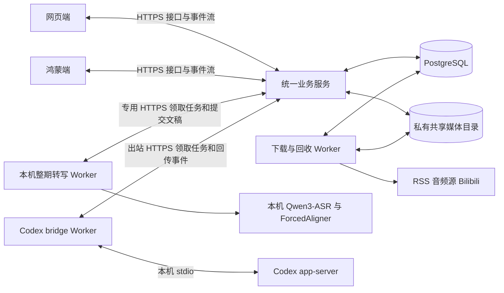

# 鱼趣知识库技术架构

更新日期：2026-11-18。基础播放同步、导入、整期转写、文稿问答与资料管理已有[公网部署记录](deployment.md)；本次未重新检查线上运行状态。近期提问锚点、选段、关键词搜索、收藏与回听恢复仅本地完成，发布仍需配套 Bridge、迁移和客户端。真机验收尚未完成。各阶段状态见[开发与验收计划](development-plan.md)，协议见[文稿与问答接口](transcripts-chat-api.md)。

## 总体结构

首版采用两个客户端、一套业务服务和独立后台工作进程。账号、播放状态、文稿、聊天的权威记录保存在云端数据库；客户端缓存与 Codex 会话均不替代业务数据库。



客户端通过受控的媒体地址获取音频，可以在鱼趣内播放。图中的业务事件只传递状态、文稿和消息，不承担音频流传输。

## 技术选择与部署边界

| 模块 | 建议选择 | 职责与边界 |
| --- | --- | --- |
| 网页 | Next.js、React、TypeScript | 极简聊天界面、自有音频播放器、状态订阅 |
| 鸿蒙 | ArkTS、ArkUI、AVPlayer | 原生播放与问答；接入 AVSession 和音频后台任务 |
| 业务 API | Node.js、TypeScript | 首版可用 Next.js Route Handlers，领域逻辑独立于路由，供两端共用 |
| 数据库 | PostgreSQL | 账号、会话、内容、进度、聊天和持久化任务队列 |
| 音频存储 | 开发使用本机私有目录；生产已有私有共享媒体卷 | 鉴权 GET/HEAD/Range；手动清理、持久回收队列及配额已实现，回收前仍计占用；不按期限自动删除 |
| 导入 Worker | 独立 Node.js 工作进程；B 站公开页面 API 与安全下载器 | 解析 BV/分 P 并下载独立 AAC 音轨，验证实际音频格式/时长；临时 CDN 地址不持久化，持续任务不占用网页请求 |
| 转写适配器 | 本机阿里 Qwen3-ASR/ForcedAligner 整期分段 Worker | 30 秒核心段加上下文，真实字词对齐，事务提交后 ACK；部分文稿可读，租约与中断恢复 |
| AI Worker | 独立 Codex bridge 进程 | 从业务服务领取任务，在隔离环境调用 Codex，回传增量与最终结果 |
| 实时传输 | HTTPS 写入，SSE 下发事件 | 网页 EventSource、鸿蒙 requestInStream 已在模拟器验证；当前采用 SSE |

首版可以使用 PostgreSQL 队列与单实例业务服务，暂不要求 Redis、独立向量数据库或微服务拆分。任务量扩大后再增加队列、检索或事件分发组件。

网页与 API 已有同一服务部署记录，正式域名为 `https://fish.sdspeed.com.cn`。导入、转写和 Bridge 独立运行；Bridge 源码在独立 `CodexBridge` 仓库，Cat 和鱼趣作为不同项目接入。Bridge 主机需要保持在线并能访问业务服务及 Codex，不由网页请求启动长期任务。

独立 Bridge 包含 Cat 的 v1 适配器和鱼趣 yuqu 适配器；鱼趣服务端队列、增量回答与聊天持久化已接入。按 2026-11-17 的部署记录，两项目已共用一个 Bridge 实例，默认总并发 2、每项目 1；业务凭据、账号、数据库、任务目录与聊天继续隔离。旧鱼趣专用实例已停止并禁用，不能为发布新功能再启动重复实例。

客户端共享 API 契约和数据语义。ArkTS 与 TypeScript 的限制不同，不假设同一套前端代码或所有 npm 包可以直接跨端运行。鸿蒙工程以 API 26 为兼容下限，实际 Release 构建与模拟器已验证，目标手机的完整系统版本及兼容性仍待核对。[华为后台播放说明](https://developer.huawei.com/consumer/en/doc/harmonyos-guides/avsession-background-scene/)

## Cat_Island 参考范围

2026-11-16 核对的依据是本地 Cat_Island 当前代码，包含未提交改动，不代表其 GitHub 默认分支或线上部署状态。

| 参考内容 | 已观察到的实现 | 鱼趣需要调整的部分 |
| --- | --- | --- |
| 邮箱登录 | 6 位验证码、SMTP 发信、数据库会话、网页 HttpOnly Cookie | 补充鸿蒙认证和设备会话管理，不照搬猫咪挑战、邀请码等产品逻辑 |
| 聊天持久化 | PostgreSQL 存消息，客户端消息 ID 与任务 ID 防重复 | 改为用户、内容、对话关系，增加历史分页、提问位置和引用 |
| Bridge | 云端任务队列，本地 Worker 出站 HTTPS 领取、执行、回传 | 增加增量事件上传、客户端推送、并发与断线恢复设计 |
| 当前聊天调用 | `codex exec --ephemeral --json`，完成后整体返回 | 建议改用 app-server 适配器获取会话及流式事件 |

主要参考文件为 `lib/auth.ts`、`lib/auth-store.ts`、`lib/resident-chat-store.ts`、`lib/codex-bridge-store.ts`、`lib/codex-cli.ts` 和 `scripts/codex-bridge.ts`。现有 app-server 使用还包括登录管理，不能把它与现有聊天生成链路混为一谈。[Cat_Island 仓库](https://github.com/OXOOOOX/Cat_Island)

鱼趣与 Cat_Island 使用独立的用户数据、数据库、会话密钥和 bridge 凭据；参考代码结构不表示共享账号或生产数据。

## 核心数据模型

下表是逻辑实体，实际持久化结构以 `db/migrations` 和领域模块为准。所有私有实体的读取、写入与事件订阅都经过用户归属校验。

| 实体 | 关键内容 |
| --- | --- |
| User、LoginChallenge、DeviceSession | 用户邮箱、一次性验证码验证状态、可撤销的设备登录会话 |
| Content、UserContent | 来源类型、来源 ID、标题、作者、原始链接、用户对该内容的访问关系 |
| MediaVersion | 音频版本、对象路径、文件摘要、实际时长与处理状态 |
| Transcript、TranscriptSegment | 文稿版本、字幕或 ASR 来源、片段起止毫秒、正文、可用区间 |
| ImportJob、TranscriptionJob | 阶段、尝试次数、租约、错误与已完成分段 |
| PlaybackSession、PlaybackSnapshot | 当前设备、内容与媒体版本、位置、倍速、状态、会话代次与事件序号 |
| PlaybackHistory | 用户各媒体版本独立保存的位置、倍率和循环设置，切回时恢复 |
| Conversation、Message | 用户、内容、消息序号、角色、正文、生成状态、客户端请求 ID |
| QuestionContext、Citation | 提问时的位置与同步依据、文稿版本、使用和引用的真实片段 |
| AIJob、AIEvent | 执行状态、租约、消息关联、增量序号、最终结果及重试信息 |
| CodexSessionMapping | 业务对话与 Worker、Codex thread 的映射，允许重建 |

B 站内容必须记录 BV 号及分 P 对应的 CID；不能只用网页 URL 作为内容和进度的唯一标识。其他来源同样需保留稳定来源标识及媒体版本。重复导入可复用已完成的处理结果，但不得因此扩大其他用户的私有内容访问权限。

## 登录与认证

已采用邮箱验证码无密码登录，参考 Cat_Island 的随机验证码、过期、发送冷却、失败次数限制和事务消费方式。当前为 6 位验证码、10 分钟有效、60 秒发送冷却、单邮箱每小时 6 次、全局每小时 120 次、验证最多 5 次、设备会话 30 天。接口及安全边界见[已实现协议](accounts-playback-api.md)。

- 网页使用 HttpOnly、SameSite=Lax Cookie，会在生产开启 Secure；所有 Cookie 写入接口核对配置的 Origin。跨标签页登录和退出通过同一 Web Lock 排序，退出在获锁后还会核对点击时的会话。
- 鸿蒙使用可撤销设备令牌，经 HTTPS Authorization 头提交，保存在系统安全存储中；服务端仅保存令牌校验摘要。
- 两端进入统一的用户鉴权层；不能把仅接受浏览器 Origin 的检查直接用于原生客户端。
- 退出撤销对应设备会话；全设备退出能力可由统一会话模型支持。
- Bridge 的工作进程认证与用户登录分开；Codex 凭据、SMTP 凭据和 B 站登录凭据不会下发给网页或手机。

## 导入、下载与转写

导入请求先产生持久化任务并返回任务 ID，再由 Worker 执行。任务按阶段存储，支持领取租约、心跳、有限重试和失败原因；进程重启后可以识别已完成工作。

当前已实现 RSS/Atom 有界预览、B 站分 P 选取、公开音轨下载与私有媒体发布。任务租约 90 秒，每 15 秒续租，最多 3 次尝试；单集上限 100 MiB/4 小时，下载时限 5 分钟。域名全部解析结果需为公网地址，并将连接固定到验证 IP；重定向重复校验。客户端展开资料库时轮询下载状态，播放同步仍通过 SSE。下载后整期 ASR 自动入队；字幕导入尚未实现。

1. 统一入口识别音频、RSS/Atom、完整 BV 与 b23 短链接，预览后确认；所有请求复用公网地址校验、固定 IP 及逐跳校验，保存归一化来源身份。
2. 获取元数据和公开独立 AAC 音轨。B 站使用网页 API，参考上游提取器并通过实际样本回归，没有调用 yt-dlp 子进程。[yt-dlp B 站适配器](https://github.com/yt-dlp/yt-dlp/blob/master/yt_dlp/extractor/bilibili.py)
3. 保存可播放媒体版本。需要转换时保留完整时间轴，不通过裁剪静音等操作改变与原视频的对应关系。
4. ASR 分段转写，将真实字词时间换算到完整音频时间轴；后续增加可用字幕的统一转换。
5. 持久化各段文稿、来源和版本，通知客户端新增可用区间。若有分段缺口，不把最大结束时间当成全部已完成范围。
6. 通过同一媒体版本完成播放和问答，抽样检查片段时间与实际声音一致。

下载只允许所支持的协议和来源，检查重定向目的地址，限制大小、时长与任务超时，避免导入接口访问服务内部地址。B 站登录内容的支持与凭据存放方式列为待定项，不假设任意视频都可下载。

## 播放同步协议

服务端维护每个用户当前认可的播放会话。主动播放或接管产生新的会话代次，原设备收到接管通知后暂停；断网设备无法被保证远程暂停，其旧会话上传也不能覆盖新会话。

每次上报至少包含内容 ID、媒体版本、设备与播放会话 ID、单调递增的事件序号、位置毫秒、状态、倍速。服务端按登录用户和会话代次检查，去重并拒绝过期或乱序事件，再分配服务器修订号；不能依赖设备时钟判断谁更新。

建议默认约 3 秒一次心跳，允许根据耗电和延迟实测在 3–5 秒间调整。暂停、跳转、倍速、切集、缓冲和结束即时发送。客户端可以根据最近位置和倍速平滑展示，但应区分估算值与上报值；超过新鲜度阈值就显示断线或过期状态，不无限向前推算。

新的主动接管采用原子条件更新，避免两个设备并发获得同一代次。重连先读取权威状态，再提交仍有效的本地事件；旧会话进度可留作历史，不无条件更新当前状态。主动回听合法，因此不能采用最大位置合并。

## 提问、Codex 与事件恢复

发送问题时，业务服务保存问题和 QuestionContext，并在同一事务内建立 AI 任务。客户端提交唯一请求 ID，网络重试不会创建重复消息或重复任务。

2026-11-18 完善：客户端在新问题首次输入时固定位置；消息记录父问题与话题根，显式追问复用父问题冻结的文稿，只带该话题最近四轮历史。原位置式请求保持旧语义。选段用转写任务 ID、完成水位和连续句 ID 定位旧快照；回答引用由原回答的已验证引用解析，不从实时文稿猜测 S 编号。新端聊天 GET 声明 `capabilities=anchored-v1`；旧端请求页包含选段消息时收到明确升级提示，保留所有历史且不伪装范围。

全文搜索和收藏复用上述文稿快照。收藏分别保存原文／回答快照与可编辑备注，清理音频保留，整期删除在同一事务清理。回听返回点只在本机内存保存；恢复请求严格核对原回听 generation、playbackSessionId 和当前 owner，不以最新代次重新抢占。

当前 QuestionContext 保存内容、媒体版本、文稿版本、冻结位置、范围和历史。服务端不把提交位置替换成更晚的播放位置。后续可补播放修订号和位置新鲜度，用于明确显示估算位置来源。

位置／范围／选段问答保留 600 段／32,000 字符上限与原有语义。新增显式 `{kind:'retrieval'}` 锚点，由服务端对当前用户有权访问的完整文稿执行问题驱动的词法检索，第一版未引入向量索引；它与用户手动全文关键词搜索是两个入口。只向 Codex 提供冻结的相关材料，文稿中的文字按资料处理，不作为执行指令。

检索策略 `lexical-v1` 使用中英文分词、简单英文词形归一、词频／稀有度评分和问题词覆盖；保留 C++／C# 等标识区别，抑制通用问法与词覆盖不足的偶然命中。每个主命中与前后邻句一起计入预算，按上下文窗口去重，避免重复说法后的纠正被丢弃。最多 48,000 段／2,000,000 字符源文稿、32 个检索词、12 个主命中窗口，最终不超过 32 段／24,000 字符，原文不裁剪、时间不重造。上限超出明确拒绝；词法召回仍会遗漏同义改述，未命中不代表节目没有相关事实。

正式发送在同一事务内冻结问题、转写任务 ID、完整水位、源句 ID 映射、检索策略和选中原文，重新编号为 S1…S32。无合格证据直接持久化确定性提示，不进入 Bridge 队列；这类话题只能重新检索。正常追问和重试复制原证据及检索 metadata，不隐式扩展来源。每条模型检索回答至少有一条有效引用，引用存在性由程序校验，语义是否支持结论仍需核对。同步检索占用请求线程且位于用户／对话锁事务内，SQL 的 statement_timeout 不限制这段 JS；极限成本和并发负载分别验证。

迁移 `0013_retrieval_chat.sql` 仅扩充 scope 约束，旧记录不重写。新任务 `yuqu.chat.retrieval.v1` 使用独立严格 schema；领取 SQL 在加租约前过滤能力，旧 Worker 不领新任务。新版聊天 GET 声明 `capabilities=anchored-v1,retrieval-v1`，返回独立 `retrievalOnline`；旧端实际读取页含检索消息时收到升级提示。离线可排队，无证据结果无需模型在线。两端独立阅读和归档文稿可检索，查看引用不接管播放。验证记录见[检索问答验收](verification/retrieval-chat.md)。

鱼趣已通过独立 CodexBridge 的 yuqu adapter 领取任务，使用本机 Codex app-server stdio，每次建立临时会话，接收最终答案增量。运行前核对有效安全配置，禁用工具并限制文件/网络权限，遇到额外工具调用立即停止。Cat adapter 保留原协议。基础问答已有正式 HTTPS 联调记录；新增 `selection` 适配仍需随近期版本发布并做真实服务验收。此前按 CLI 0.169.0 协议完成联调，后续升级时重新核对兼容性，模型沿用本机配置。[Codex app-server 官方文档](https://learn.chatgpt.com/docs/app-server)

- 同一业务对话串行执行生成；不同用户、对话的上下文和工作目录隔离。
- Worker 的文件和工具权限仅覆盖必要工作环境；音频与文稿不会因此获得执行任意命令的权限。
- Worker 将带执行代次和序号的增量批量回传，服务端持久化后推送；完成状态只在最终结果落库后发布。
- 对话消息是业务事实来源。Codex thread 丢失或 Worker 更换时，可从已保存的历史和文稿重建上下文，客户端聊天记录不因此丢失。
- 引用由服务端核对到文稿片段；不直接信任模型生成的时间戳。
- Worker 失联后将任务标为中断或待恢复，保留已收到文本；状态不明时不自动并发重跑。重试使用新执行代次，并阻止旧执行覆盖新结果。无法保证外部模型调用只发生一次，应单独记录实际尝试。

当前播放通过带游标 SSE 同步；资料库、文稿与聊天分别轮询各自快照，重连读取持久记录。没有将文稿/聊天序号混入播放修订号。浏览器和鸿蒙均按用户鉴权，令牌不放入 URL 查询参数。后续可统一事件流，但需保留各资源独立版本。

## 章节派生数据

章节独立于播放、聊天和转写队列。迁移 `0012_chapters.sql` 建立 `chapter_documents` 与 `chapter_batches`；文档固定用户、媒体、转写任务、完成水位与 `semantic-chapters-v1` 策略。完整文稿按最多 600 句／24,000 字符拆成模型输入批次，最多 128 批，原文全部持久保存，超过上限明确拒绝而不截断。

独立 Bridge 通过 `yuqu.transcript.chapters.v1` 领取任务；同一文档逐批执行，聊天优先于章节。模型只输出标题、连续 S 编号和是否续接前章；服务端复核完整、连续、无重叠覆盖，将原始句 ID 与最小起点／最大终点保存为章节。片段时间可以重叠或为零，不能强制全局单调或伪造时长。后批首章可续接前章，保留原章身份与标题，扩展范围；原始批结果保持不变。

租约 120 秒，Bridge 每 10 秒心跳；每批最多 3 次自动尝试。过期租约不可提交；手动重试仅重排未完成批次，取消退役未完成租约。每用户最多 2 份活跃章节任务，同一版本生成幂等复用。GET `/api/media/:id/chapters` 按文档 ID 与偏移分页，每页 40 条；POST 支持 generate／retry／cancel。两端只在展开与前台时刷新目录，查看原文与播放操作分开。

清理音频保留章节和源文稿，整期删除通过外键级联清理文档与批任务。派生章节不写回转写、不改变旧提问或收藏快照。未来重转写必须创建独立版本；本轮没有增加替换旧文稿的入口。实现与本地验证见[章节验收](verification/chapters-navigation.md)。

## 分段与整期总结

迁移 `0014_summaries.sql` 建立独立 `summary_documents` 与 `summary_nodes`，不覆盖转写、聊天、章节或收藏。当前策略为 `topic-complete-summary-v3`：冻结完整文稿任务 ID、水位及原句顺序，按约 5 分钟跨度、600 原句、23,000 文本字符和 55,000 预估序列化字符分批；最多 128 批，源文稿总上限 48,000 原句／2,000,000 字符。单条原文最多 8,000 字符；不能为满足时间或上下文软边界拆造原句，单句过长时完整保留，零时长、重叠和原顺序不改。最终分段 payload 超过 60,000 序列化字符时明确拒绝，不截断。总结不依赖预生成章节，只接收完成水位等于实际时长的 ready 文稿。

叶节点使用 `yuqu.transcript.summary.part.v2`。发送模型前把相邻原句组成不重叠的连续上下文单元：正常单元最多 4 原句、4,000 字符、30 秒，邻句间隔不超过 2 秒；单条原文超过字符或时长软边界时仍完整保留。局部 `S1` 等编号绑定整个冻结单元，模型只返回标题和 1–12 个要点，每点引用 1–4 个 S 编号。服务端将这些编号还原成原句，按原始顺序去重，每点最多 16 条；原文文字、ID 与时间均不接受模型重写。 Bridge 先生成草稿，再在新的无工具会话中用同一冻结原文和草稿独立复核；只提交复核结果，复核失败不回退草稿。两次调用分别执行既有取消／超时边界，完整提示最多 100,000 字符、输出最多 24,000 字符。

每 8 个已完成子节点通过 `yuqu.transcript.summary.overview.v2` 归组一次，最多 3 级、147 个总节点。即使只有一段也创建主题根节点。一次父任务最多接收 96 个 `P1` 等项目，输出 1–12 个主题及每个主题的 `itemIds`；全部 P 项必须恰好使用一次，缺项、重复、无效编号或重复主题名会被拒绝。模型只命名和分组，服务端继承叶节点的完整要点正文、真实 `nodeId`／`pointIndex` 与依据；上层用于选组的文字提示可缩到 240 字符，但持久化叶正文不截断、不重写。整份文档最多保留 1,536 个叶要点。这个约束消除了父级选点压缩造成的结构性丢点，不能证明叶阶段没有遗漏原文主题，也不能证明全部引用在语义上充分。

全部节点先持久化，同一文档逐个领取，聊天和章节任务优先。新旧任务能力在加租约前过滤，在线状态按当前客户端能力检查对应的两种总结任务。租约 120 秒、最多 3 次自动尝试，首次领取保存不可变模型输入；失败／停止仅重排未完成节点，完成节点不重新生成。每用户最多两份活跃文档，同转写版本、水位和策略复用结果，同提交标识始终返回原文档。显式“重新整理总结”使用新提交标识创建 v3 文档，旧 `hierarchical-summary-v1`、`time-bounded-summary-v2` 记录、输入与依据保留；本轮无新增迁移，也不修改既有迁移校验值。依赖失败时不继续归并，也不占用活跃额度。

新客户端在总结 GET／POST 中声明 `capabilities=summary-topics-v1`，旧格式仍能读取；旧客户端读取 v3 文档收到 `409 CLIENT_UPGRADE_REQUIRED`。GET `/api/media/:id/summaries` 每页 8 个已完成分段，继续页绑定 documentId；进度只读有界元数据。v3 文档带 `format: 'topics-v1'`，完成后 `overview=null`、`topicOverview` 返回主题标题和要点数；旧格式继续使用 `overview`。未完成文档不展示整期内容。

GET `/summaries/topics` 按 documentId、topicIndex 和 after 每页读取最多 20 个主题要点，不一次发送整期正文。GET `/summaries/evidence` 继续按原叶 nodeId 和 pointIndex 读取冻结原句，v3 索引为 0–11，旧格式为 0–5。两端校验媒体、文档、主题、快照、页长与游标，按需展开且不自动播放；切主题、分页、收起、退出或换文档使旧主题／依据请求失效。成功生成重置分页并释放提交标识，响应丢失则复用。清理音频保留文字并禁用回听，显式回听始终绑定依据媒体；整期删除级联移除文档和任务，旧租约不可提交。提示词与审阅要求保持条件、否定及补充／纠正区别，语义质量另验。新验证见[主题覆盖与引用完整性](verification/summary-coverage.md)，[首版](verification/summaries.md)与[v2 复验](verification/summary-quality.md)保留为历史证据。

## 接口边界与目录

| 接口组 | 主要操作 |
| --- | --- |
| 登录 | 申请验证码、验证、读取当前用户、退出和撤销设备会话 |
| 内容 | 创建导入、查询任务、列出资料、读取媒体与文稿、重试失败阶段 |
| 播放 | 主动开始或接管、上报状态、读取当前快照 |
| 对话 | 获取内容对话、分页读取消息、幂等发送问题、重试或取消生成 |
| 章节 | 读取固定文稿的章节目录、按需生成、失败续接和取消 |
| 总结 | 分段分页、整期主题目录与要点分页、旧概览兼容、逐点冻结依据、生成／续做／停止 |
| 事件 | 经过鉴权的实时订阅、断线恢复 |
| Worker 内部接口 | 领取任务、续租、回传进度与增量、提交最终结果 |

HTTP JSON 契约以 `packages/contracts`、账户与播放协议及文稿与问答协议记录，时间统一使用毫秒，持久化时间使用 UTC。接口变更由两端共同验收，兼容边界随版本记录。

```text
apps/web/               网页与首版 API 入口
apps/harmony/           鸿蒙工程
packages/domain/        服务端业务规则与服务
packages/contracts/     API 与事件契约，供两端按各自语言适配
workers/ingestion/      下载、媒体检查及持久回收任务
workers/transcription/  本机整期转写、远端队列接入与服务监管
workers/codex-bridge/   独立 CodexBridge 的鱼趣接入说明（运行实现在独立仓库）
db/migrations/         数据库迁移
docs/                  项目文档
```

上述模块已有实现。新增搜索／收藏及提问契约以近期验收记录为准；源码完成、实际发布与真机验收分别维护状态。

## V2 官方播放器的扩展点

播放器来源在业务层区分为自有媒体和官方嵌入；文稿、对话和来源身份共用模型，进度来源另行记录为播放器实测、用户指定或过期快照。

网页评估官方 iframe，鸿蒙评估应用内网页容器。官方 `t` 参数表示初始播放位置，不能当成已经提供连续进度订阅或任意时刻控制能力。缺少可靠回调时不生成虚假的实时进度，不把 V1 自有播放器的同步验收自动套到 V2。[B 站官方嵌入参数](https://player.bilibili.com/)

先验证平台行为，自动定位通过才逐端开放 V2 视频，不推出手动定位降级版；音频功能可独立交付。读取独立 B 站网页或官方 App 的外部进度属于更后期，和本节的应用内嵌入分开规划。
